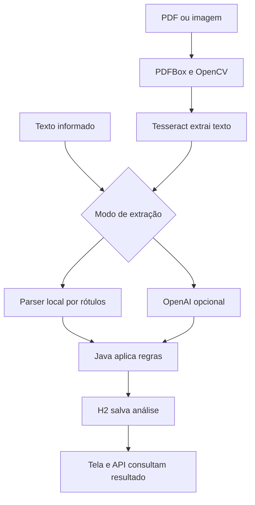

# Validação de Certificados de Atividades Complementares

MVP acadêmico da mentoria Avanade / Residência Tecnológica, ADS, CESAR School, 2026.2.

**Aluno:** Luis Lucena Wanderley Galindo  
**Mentor:** Kleber Meira  
**Apresentação:** 25/11/2026

A aplicação recebe um certificado de curso ou oficina, extrai seus campos, confere regras e salva o resultado para consulta. O objetivo é ajudar na triagem de horas complementares.

**Status:** versão funcional para demonstração local. Possui interface web, API Java, regras, histórico persistente e leitura por OCR. A extração com IA é opcional e exige chave própria; o modo padrão usa campos rotulados e não chama IA.

## Executar

### Mais simples para ver a demonstração

Com **Java 21** instalado, execute `iniciar.bat` no Windows ou `sh iniciar.sh` no Linux/macOS. Depois abra **http://localhost:8080**.

O pacote de entrega inclui um JAR em `bin/`, então a demonstração por texto funciona sem Maven, Python, OCR, internet ou chave de IA. Ao clonar o repositório sem o JAR, o script compila primeiro com o Maven Wrapper e precisa de internet nessa primeira execução. O terminal deve permanecer aberto. Encerre com `Ctrl+C`.

### GitHub Codespaces (inclui OCR)

1. Suba os arquivos do projeto para o seu repositório, incluindo `.devcontainer` e `.mvn`.
2. No GitHub, abra **Code > Codespaces > Create codespace**.
3. Aguarde a criação do ambiente. No terminal, execute `sh iniciar.sh`.
4. Abra a porta **8080** em **Ports**. Mantenha a visibilidade privada.

A configuração de ambiente inclui Java 21, Maven, Python/OpenCV e Tesseract com idioma português. A primeira criação precisa baixar as dependências. Codespaces não é necessário para quem roda localmente.

### Docker (inclui OCR)

Com Docker e Compose instalados:

```bash
docker compose up --build
```

Abra http://localhost:8080. A primeira execução baixa imagens e compila o projeto. Os resultados ficam em `dados/`, também ao usar Docker. Encerre com `Ctrl+C`.

### Compilar e testar manualmente

Java 21 é obrigatório. O Maven Wrapper está incluído.

```bash
# Linux/macOS
sh ./mvnw test
sh ./mvnw package
java -jar target/validacao-certificados.jar
```

No Windows, substitua `sh ./mvnw` por `mvnw.cmd`.

Após alterar código ou arquivos da interface, rode `mvnw package` novamente. O script de início prioriza o JAR de `target/` sobre o JAR de entrega em `bin/`.

Pendência do MVP: a tela de decisão final pela coordenação ainda não foi implementada; os resultados são de triagem.

## Demonstração em dois minutos

1. Selecione **Ana Costa** e mantenha **Texto de exemplo**, sem IA.
2. Clique em **Completo** e depois em **Analisar certificado**: aprovado na triagem.
3. Envie o mesmo texto novamente: rejeitado por duplicidade.
4. Clique em **Sem carga horária** e analise: pendente.
5. Clique em **Datas inconsistentes** e analise: rejeitado, com o motivo.
6. Abra uma análise pelo histórico e mostre os campos, as etapas e o JSON.
7. Se o OCR estiver instalado, envie `exemplos/certificado-valido.png` ou `.pdf` pela aba de arquivo.

O PNG, o PDF e o texto completos representam o **mesmo certificado**, com o mesmo código. Se o texto já foi aprovado, o envio do PNG/PDF será corretamente rejeitado por duplicidade. Para mostrar aprovação via OCR, faça o upload antes da primeira análise por texto.

Se um exemplo completo já estiver salvo, ele continuará duplicado após reiniciar. Para uma demonstração do zero, pare a aplicação e **apague apenas a pasta `dados/` deste projeto**. Isso remove todo o histórico local. A pasta é recriada ao iniciar.

## Cenário e usuários

A coordenação precisa conferir nomes, datas e horas em certificados. Documentos incompletos e envios repetidos geram retrabalho.

- **Aluno:** envia o certificado e consulta a triagem.
- **Coordenação:** utiliza os dados e os motivos como apoio à conferência.

Neste MVP, dois alunos fictícios já estão disponíveis: Ana Costa e Bruno Lima, ambos com ingresso em 01/01/2025. Não há cadastro de usuários nem login. O resultado não concede horas automaticamente.

## Documentos e informações extraídas

Um certificado de curso livre ou oficina, com uma página, em **PDF, PNG ou JPG**, até **5 MB** e imagem de até **20 megapixels**. PDFs protegidos ou corrompidos não são aceitos. O modo texto aceita até 20.000 caracteres.

| Campo | Obrigatório |
| --- | --- |
| Participante | Sim |
| Atividade | Sim |
| Instituição emissora | Sim |
| Carga horária | Sim |
| Início, término e emissão | Sim |
| Código do certificado | Não |

No modo local, o texto precisa ter os rótulos dos exemplos, um por linha:

```text
Participante: Ana Costa
Atividade: Oficina de Java
Instituicao: Escola Exemplo
Carga horaria: 12 horas
Inicio: 01/10/2026
Termino: 02/10/2026
Emissao: 03/10/2026
Codigo: JAVA-2026-001
```

Rótulos aceitam acentos, espaços extras e diferenças entre maiúsculas e minúsculas. Datas aceitam `dd/MM/aaaa` ou `aaaa-MM-dd`. Campos não reconhecidos ficam nulos. Dois rótulos iguais tornam aquele campo ambíguo e ele é descartado. O parser local não interpreta qualquer certificado em texto livre.

## Regras e resultados

As regras são propostas do exercício, **não um regulamento oficial da faculdade**.

- Campos obrigatórios precisam ser identificados.
- Nome deve corresponder ao aluno escolhido, desconsiderando acentos, caixa e espaços extras. Divergência fica pendente para conferência.
- Carga horária deve ser maior que zero.
- Início não pode ser posterior ao término nem anterior ao ingresso do aluno.
- Emissão não pode ser anterior ao término nem estar no futuro. A referência de data é America/Fortaleza.
- Arquivo/texto idêntico já aprovado na triagem para o aluno é duplicado (hash SHA-256).
- Emissor e código iguais aos de um certificado aprovado para o aluno também indicam duplicidade.
- Sem código em um dos registros, coincidência de atividade, emissor e período fica pendente por possível duplicidade.

| Resultado | Significado |
| --- | --- |
| `APROVADO_NA_TRIAGEM` | Regras atendidas, aguardando avaliação acadêmica fora do sistema |
| `PENDENTE` | Campo ausente, data ilegível/inválida, nome divergente ou possível duplicidade |
| `REJEITADO` | Regra descumprida, como horas zero, datas incoerentes ou duplicidade confirmada |

Quando existem erros e pendências ao mesmo tempo, prevalece `REJEITADO` e todos os motivos são mostrados. Uma falha técnica no OCR ou na IA retorna erro HTTP e não cria uma análise rejeitada.

## Fluxo e tecnologias



| Parte | Escolha |
| --- | --- |
| Backend | Java 21, Spring Boot 3.5.5, Maven |
| Banco | H2 em arquivo, acessado com JdbcTemplate |
| PDF | PDFBox 3.0.5 renderiza a página como imagem |
| Pré-processamento | Python/OpenCV: cinza e limiar de Otsu |
| OCR | Executável Tesseract com idioma português |
| Extração opcional com IA | API OpenAI, modelo configurável |
| Interface | HTML, CSS e JavaScript, servidos pelo Spring Boot |
| Testes | JUnit e MockMvc |

O banco registra aluno, dados extraídos, texto, status, motivos, etapas e hash. O arquivo original não é armazenado: as imagens intermediárias são temporárias e apagadas após a leitura. Esta é uma simplificação em relação à proposta inicial.

## Instalar OCR localmente (opcional)

No Ubuntu/Debian:

```bash
sudo apt-get update
sudo apt-get install python3-opencv tesseract-ocr tesseract-ocr-por
```

Em outro ambiente com Python, instale `python -m pip install -r scripts/requirements.txt` e instale o Tesseract separadamente, incluindo `por.traineddata`. Apenas instalar o pacote Python não instala o Tesseract.

No Windows, configure os caminhos no PowerShell antes de iniciar, conforme sua instalação:

```powershell
$env:PYTHON_COMMAND="python"
$env:TESSERACT_COMMAND="C:\Program Files\Tesseract-OCR\tesseract.exe"
.\iniciar.bat
```

`OCR_LANGUAGE` pode mudar o idioma (padrão `por`). `TESSDATA_PREFIX` pode apontar para a pasta que contém os arquivos de idioma. Os comandos devem ser executáveis, não comandos completos com argumentos.

A aplicação informa quando essas ferramentas não estão disponíveis. O modo texto continua funcionando, mas não é apresentado como OCR.

## Ativar IA (opcional)

A opção vem desmarcada. Para ativá-la, configure uma chave com acesso à API e reinicie a aplicação:

```bash
export OPENAI_API_KEY="sua-chave"
sh iniciar.sh
```

PowerShell:

```powershell
$env:OPENAI_API_KEY="sua-chave"
.\iniciar.bat
```

O modelo padrão é `gpt-4o-mini`, configurável em `OPENAI_MODEL`. A API pode ter cobrança independente da assinatura do ChatGPT. Não coloque a chave no código ou no GitHub. O texto do certificado é enviado ao serviço externo somente quando a opção de IA está marcada.

A IA recebe o texto e devolve JSON; Java aplica as regras. Campos retornados são comparados com o texto e valores sem evidência são descartados. A checagem é simples, não uma garantia contra erros. Se a API falhar, o sistema informa o erro, sem fingir que usou IA. Para continuar, desmarque a opção e use os modelos rotulados.

**Validação da entrega:** o contrato HTTP da integração foi testado com um servidor local simulado. Não houve chamada real paga à OpenAI nem validação da qualidade de um modelo remoto nesta entrega.

## API REST

| Método | Rota | Uso |
| --- | --- | --- |
| GET | `/api/alunos` | Alunos fictícios disponíveis |
| GET | `/api/config` | Informa se há chave configurada, sem expô-la |
| POST | `/api/analises/texto` | Analisa texto enviado em JSON |
| POST | `/api/analises/arquivo` | Upload multipart com `alunoId`, `arquivo`, `usarIa` |
| GET | `/api/analises` | Últimas 100 análises |
| GET | `/api/analises/{id}` | Uma análise completa |

Exemplo de JSON:

```json
{
  "alunoId": "1",
  "texto": "Participante: Ana Costa\nAtividade: Oficina de Java\nInstituicao: Escola Exemplo\nCarga horaria: 12 horas\nInicio: 01/10/2026\nTermino: 02/10/2026\nEmissao: 03/10/2026\nCodigo: JAVA-2026-001",
  "usarIa": false
}
```

Uma análise criada retorna **201** e cabeçalho `Location`, mesmo quando a triagem a rejeita: o registro foi criado com sucesso. O resultado do documento está no campo `status` do JSON.

Outros códigos: **200** consulta, **400** entrada inválida, **404** análise inexistente, **413** upload grande demais, **415** formato não aceito, **502** falha na resposta da IA e **503** dependência indisponível.

## Organização do código

| Arquivo / pasta | Responsabilidade |
| --- | --- |
| `Api.java` | Receber requisições HTTP |
| `Certificados.java` | Juntar extração, duplicidade, regras e gravação |
| `Validador.java` | Regras do certificado |
| `Extrator.java` | Parser local e integração opcional com IA |
| `Ocr.java` | PDF/imagem, OpenCV e Tesseract |
| `Banco.java` | Salvar e consultar no H2 |
| `Modelos.java` | Records usados pela aplicação |
| `Texto.java`, `Erros.java` | Normalização, datas e erros da API |
| `src/main/resources/static/` | Interface e exemplos para download |
| `src/test/` | Testes automatizados |
| `scripts/preprocessar.py` | Tratamento da imagem com OpenCV |
| `exemplos/` | Certificados fictícios em TXT, PNG e PDF |
| `docs/` | Registro das verificações do projeto |

## O que mudou desde a proposta

A proposta e o README inicial foram preparados em **25/09/2026**. A implementação deste pacote foi consolidada em **19/11/2026**. Essas datas descrevem os artefatos; não representam commits anteriores.

- PostgreSQL foi substituído por H2 em arquivo para reduzir a configuração necessária.
- Um único tipo documental foi mantido: certificados, com cursos e oficinas no mesmo modelo.
- O modo local permite demonstrar as regras sem depender de uma API paga.
- A revisão humana e a confirmação de horas ficaram fora da interface desta versão.
- Os arquivos originais não são guardados; o texto extraído e o resultado ficam no banco.

## Limitações e próximos passos

O protótipo foi feito para execução local com dados fictícios. Não possui autenticação, autorização por aluno, edição de cadastro ou fluxo de aprovação final. Por padrão o servidor escuta apenas `127.0.0.1`; Docker publica a porta somente no localhost. Não deve ser exposto como serviço público com documentos reais.

O OCR funciona melhor com imagens nítidas e alinhadas. O pré-processamento não corrige perspectiva nem rotação. O parser local atende os modelos rotulados fornecidos. A IA não garante leitura correta de qualquer layout. A detecção de repetição é básica; não há verificação de assinatura ou consulta ao emissor.

Próximos passos: revisão manual com registro da decisão, cadastro e autenticação, mais modelos de certificado, armazenamento controlado do original e regras oficiais de aproveitamento.

## Referências e apoio

- [Orientação do mentor](https://github.com/KleberMeira/analise-documento-ia).
- [IDP de Luís Nunes](https://github.com/Luisr-nunes/IDP): referência de escopo e documentação. Esta implementação foi escrita para o cenário de certificados.
- [Tesseract](https://github.com/tesseract-ocr/tesseract).
- [OpenCV: thresholding](https://docs.opencv.org/4.x/d7/d4d/tutorial_py_thresholding.html).
- [Status HTTP](https://developer.mozilla.org/pt-BR/docs/Web/HTTP/Reference/Status).
- Materiais da mentoria enviados no Discord.

O desenvolvimento desta versão contou com assistência de IA para gerar, revisar e testar código e documentação.
